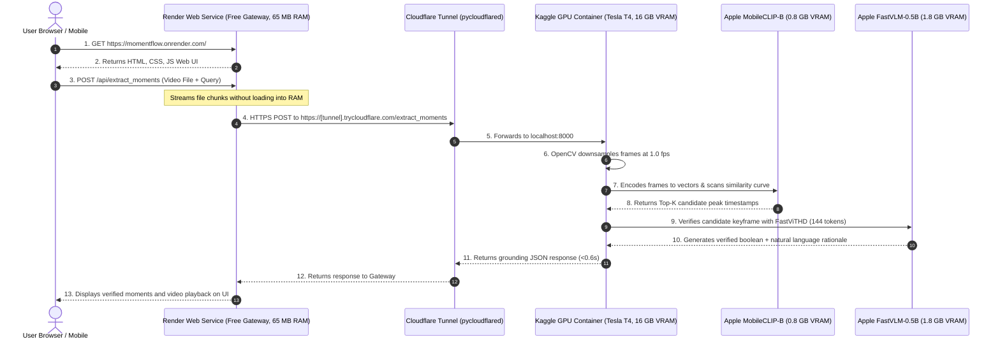

# MomentFlow: Exhaustive Free Production Deployment Guide (Render + Kaggle Hybrid)

---

## 1. System Architecture & Request Lifecycle

This guide maps the complete production deployment of **MomentFlow** across two complementary free-tier platforms:
1. **Frontend & Gateway Layer (Render Free Tier)**: Serves the static Web UI, handles HTTP routing, and proxies inference requests with a memory footprint under **65 MB RAM**.
2. **High-Performance ML Inference Layer (Kaggle Free GPU)**: Executes the Apple 2-Model stack (`apple/MobileCLIP-B` + `apple/FastVLM-0.5B`) in CUDA FP16 on an **Nvidia Tesla T4 / P100 (16 GB VRAM)**, exposed to Render via an authenticated, zero-trust **Cloudflare Tunnel**.

### End-to-End Data Flow Architecture



---

## 2. Technical Tools & Algorithms Used

| Component | Technical Tool | Configuration / Precision | Memory / VRAM Footprint |
| :--- | :--- | :--- | :--- |
| **Web Gateway** | FastAPI + Uvicorn | Python 3.11+, ASGI async streaming | **~65 MB RAM** |
| **HTTP Client** | HTTPX AsyncClient | `timeout=300.0s`, chunked transfer | ~10 MB RAM |
| **Networking Tunnel** | Cloudflare Tunnel (`pycloudflared`) | Ephemeral Zero-Trust HTTPS egress | ~15 MB RAM |
| **Model 1: Candidate Search** | `apple/MobileCLIP-B` (OpenCLIP) | CUDA FP16, `datacompdr` weights | **0.8 GB VRAM** |
| **Model 2: Action Verifier** | `apple/FastVLM-0.5B` (Hugging Face) | CUDA FP16, FastViTHD compression | **1.8 GB VRAM** |
| **Frame Sampling** | OpenCV (`cv2.VideoCapture`) | 1.0 fps uniform temporal sampling | Dynamic buffer (< 200 MB) |

---

## 3. Phase 1: Deploying the Compute Engine on Kaggle (Step-by-Step)

Kaggle provides **30 hours per week** of free GPU compute. Using Kaggle's **Batch Commit Mode**, the model server runs in the background on Google Cloud for up to **12 continuous hours** without requiring an open browser tab.

### Step 1.1: Create Kaggle Notebook & Configure Hardware
1. Open [kaggle.com/code](https://www.kaggle.com/code) and click **New Notebook**.
2. On the right-hand **Notebook options** sidebar:
   - **Accelerator**: Click and select **GPU T4 x2** or **GPU P100** *(Mandatory: allocates 16 GB VRAM)*.
   - **Internet**: Toggle switch to **On** *(Mandatory: enables downloading model weights and the Cloudflare tunnel binary)*.
   - **Language**: `Python`
   - **Environment**: `Always use latest environment`

---

### Step 1.2: Enter Notebook Code Cells
Copy the exact cells from [`Prototype/kaggle_deployment.ipynb`](file:///Users/abhinav/Desktop/jobs/projects/MomentFlow/Prototype/kaggle_deployment.ipynb):

#### Cell 1: Hardware & CUDA Verification
```python
!nvidia-smi
import torch
assert torch.cuda.is_available(), "GPU Accelerator not enabled! Set Accelerator -> GPU in settings."
print(f"CUDA Device Name: {torch.cuda.get_device_name(0)}")
print(f"Total VRAM: {torch.cuda.get_device_properties(0).total_memory / (1024**3):.2f} GB")
```

#### Cell 2: Install Libraries
```python
!pip install --upgrade pip -q
!pip install open_clip_torch transformers accelerate timm opencv-python-headless fastapi uvicorn pycloudflared python-multipart pillow pydantic httpx -q
print("All dependencies installed successfully!")
```

#### Cell 3: Write Standalone GPU Server Script
```python
with open("kaggle_server.py", "w") as f:
    f.write('''
import os, sys, time, tempfile, threading
from typing import Optional, List, Dict, Any
import cv2, numpy as np, torch
from PIL import Image
from pydantic import BaseModel
import uvicorn
from fastapi import FastAPI, File, UploadFile, Form, HTTPException
from fastapi.middleware.cors import CORSMiddleware
from fastapi.responses import HTMLResponse
from pycloudflared import try_cloudflare
import open_clip
from transformers import AutoModelForCausalLM, AutoProcessor

DEVICE = "cuda:0" if torch.cuda.is_available() else "cpu"
DTYPE = torch.float16 if torch.cuda.is_available() else torch.float32

print(f"[MomentFlow] Initializing Apple Stack on {DEVICE} ({DTYPE})...")
t0 = time.perf_counter()

# Load Apple MobileCLIP-B
clip_model, _, clip_prep = open_clip.create_model_and_transforms("MobileCLIP-B", pretrained="datacompdr", device=DEVICE)
clip_tok = open_clip.get_tokenizer("MobileCLIP-B")
clip_model = clip_model.to(dtype=DTYPE).eval()
print(f"[MomentFlow] Model 1: Apple MobileCLIP-B loaded in {time.perf_counter() - t0:.2f}s")

# Load Apple FastVLM-0.5B
t1 = time.perf_counter()
vlm_proc = AutoProcessor.from_pretrained("apple/FastVLM-0.5B", trust_remote_code=True)
vlm_model = AutoModelForCausalLM.from_pretrained("apple/FastVLM-0.5B", torch_dtype=DTYPE, device_map=DEVICE, trust_remote_code=True).eval()
print(f"[MomentFlow] Model 2: Apple FastVLM-0.5B loaded in {time.perf_counter() - t1:.2f}s")
vram = torch.cuda.memory_allocated(0)/(1024**3) if torch.cuda.is_available() else 0
print(f"[MomentFlow] Total VRAM Allocated: {vram:.2f} GB / 16.0 GB")

app = FastAPI(title="MomentFlow Apple GPU Engine", version="2.0.0")
app.add_middleware(CORSMiddleware, allow_origins=["*"], allow_methods=["*"], allow_headers=["*"])

@app.get("/")
def index():
    return HTMLResponse("""
    <html><head><title>MomentFlow GPU Backend</title></head>
    <body style="font-family:system-ui;max-width:700px;margin:50px auto;background:#0f172a;color:#f8fafc;padding:25px;border-radius:12px;">
        <h1 style="color:#38bdf8;">🚀 MomentFlow Apple GPU Backend</h1>
        <p>Serving <b>Apple MobileCLIP-B</b> and <b>Apple FastVLM-0.5B</b> on Nvidia CUDA FP16.</p>
        <p><a style="color:#818cf8;" href="/docs">OpenAPI Docs</a> | <a style="color:#818cf8;" href="/health">Health Status</a></p>
    </body></html>
    """)

@app.get("/health")
def health():
    return {
        "status": "healthy",
        "device": DEVICE,
        "device_name": torch.cuda.get_device_name(0) if torch.cuda.is_available() else "CPU",
        "vram_allocated_gb": round(torch.cuda.memory_allocated(0)/(1024**3), 2) if torch.cuda.is_available() else 0,
        "models": ["apple/MobileCLIP-B", "apple/FastVLM-0.5B"]
    }

@app.post("/extract_moments")
async def extract_moments(file: UploadFile = File(...), query: str = Form(...), sample_fps: float = Form(1.0), top_k: int = Form(3)):
    t_start = time.perf_counter()
    with tempfile.NamedTemporaryFile(suffix=".mp4", delete=False) as tmp:
        tmp.write(await file.read())
        tmp_path = tmp.name

    try:
        cap = cv2.VideoCapture(tmp_path)
        fps = cap.get(cv2.CAP_PROP_FPS) or 30.0
        total_frames = int(cap.get(cv2.CAP_PROP_FRAME_COUNT) or 0)
        duration = total_frames / fps if fps > 0 else 0.0
        step = max(1, int(round(fps / max(0.1, sample_fps))))

        timestamps, pil_frames = [], []
        c = 0
        while cap.isOpened():
            ret, frame = cap.read()
            if not ret: break
            if c % step == 0:
                timestamps.append(c / fps)
                pil_frames.append(Image.fromarray(cv2.cvtColor(frame, cv2.COLOR_BGR2RGB)))
            c += 1
        cap.release()
        if not pil_frames: raise HTTPException(400, "Could not decode video frames")

        t_s1 = time.perf_counter()
        with torch.no_grad():
            q_tok = clip_tok([query]).to(DEVICE)
            q_vec = clip_model.encode_text(q_tok)
            q_vec = (q_vec / q_vec.norm(dim=-1, keepdim=True)).squeeze(0).cpu().to(torch.float32).numpy()
            tensors = torch.stack([clip_prep(img) for img in pil_frames]).to(device=DEVICE, dtype=DTYPE)
            f_vecs = clip_model.encode_image(tensors)
            f_vecs = (f_vecs / f_vecs.norm(dim=-1, keepdim=True)).cpu().to(torch.float32).numpy()

        similarities = f_vecs @ q_vec
        s1_latency = time.perf_counter() - t_s1

        sorted_idx = np.argsort(-similarities)
        chosen = []
        for idx in sorted_idx:
            t_peak = timestamps[idx]
            if all(abs(t_peak - timestamps[c]) >= 5.0 for c in chosen):
                chosen.append(idx)
            if len(chosen) >= top_k: break

        moments = []
        for rank, idx in enumerate(chosen, start=1):
            peak_time = timestamps[idx]
            keyframe = pil_frames[idx]
            q_prompt = f"Does this video frame depict: '{query}'? Answer 'Yes' or 'No', followed by a one-sentence factual reason."
            messages = [{"role": "user", "content": [{"type": "image"}, {"type": "text", "text": q_prompt}]}]
            prompt_str = vlm_proc.apply_chat_template(messages, add_generation_prompt=True)
            inputs = vlm_proc(text=prompt_str, images=[keyframe], return_tensors="pt").to(DEVICE)

            with torch.no_grad():
                out = vlm_model.generate(**inputs, max_new_tokens=50, do_sample=False, pad_token_id=vlm_proc.tokenizer.pad_token_id or vlm_proc.tokenizer.eos_token_id)
            gen_text = vlm_proc.decode(out[0][inputs.input_ids.shape[1]:], skip_special_tokens=True).strip()

            moments.append({
                "rank": rank,
                "start": round(max(0.0, peak_time - 4.0), 2),
                "end": round(min(duration, peak_time + 4.0), 2),
                "peak": round(peak_time, 2),
                "clip_score": round(float(similarities[idx]), 4),
                "verified": gen_text.lower().startswith("yes"),
                "explanation": gen_text
            })

        return {
            "status": "success",
            "query": query,
            "video_duration_seconds": round(duration, 2),
            "stage1_latency_sec": round(s1_latency, 3),
            "total_latency_sec": round(time.perf_counter() - t_start, 3),
            "moments": moments
        }
    finally:
        if os.path.exists(tmp_path): os.remove(tmp_path)

if __name__ == "__main__":
    tunnel = try_cloudflare(port=8000)
    print("\\n" + "="*70)
    print("🚀 MOMENTFLOW KAGGLE GPU SERVER IS READY!")
    print(f"👉 CLOUDFLARE PUBLIC URL: {tunnel.tunnel}")
    print("👉 Copy the URL above and set as KAGGLE_BACKEND_URL in Render!")
    print("="*70 + "\\n", flush=True)
    uvicorn.run(app, host="0.0.0.0", port=8000)
''')
print("Server script written to kaggle_server.py!")
```

#### Cell 4: Launch Server Process
```python
!python kaggle_server.py
```

---

### Step 1.3: Run in Headless Background Mode ("Save & Run All")
To run the server continuously for up to 12 hours without keeping your browser open:
1. In the top-right corner of the Kaggle notebook editor, click **Save Version**.
2. Select **Version type: Save & Run All (Commit)**.
3. Click **Save**.
4. **Close your browser tab or laptop.** Kaggle provisions an independent VM in Google Cloud.
5. In your Kaggle account, go to **Your Work $\rightarrow$ Code $\rightarrow$ [Notebook Name] $\rightarrow$ Logs**.
6. Locate the logged Cloudflare URL:
   ```
   ======================================================================
   🚀 MOMENTFLOW KAGGLE GPU SERVER IS READY!
   👉 CLOUDFLARE PUBLIC URL: https://random-subdomain.trycloudflare.com
   👉 Copy the URL above and set as KAGGLE_BACKEND_URL in Render!
   ======================================================================
   ```
7. Copy this URL (e.g. `https://rapidly-xxx.trycloudflare.com`).

---

## 4. Phase 2: Deploying the Web Gateway on Render (Step-by-Step)

Render will host the public Web UI and reverse-proxy all grounding requests to the Kaggle GPU backend.

### Step 2.1: Prepare Repository on GitHub
Ensure your repository contains the pre-configured Render files:
- [`render.yaml`](file:///Users/abhinav/Desktop/jobs/projects/MomentFlow/render.yaml) (Blueprint configuration)
- [`Prototype/render_gateway.py`](file:///Users/abhinav/Desktop/jobs/projects/MomentFlow/Prototype/render_gateway.py) (Lightweight Gateway)
- [`Prototype/requirements-render.txt`](file:///Users/abhinav/Desktop/jobs/projects/MomentFlow/Prototype/requirements-render.txt) (Strict 65 MB RAM dependencies)
- [`Prototype/static/`](file:///Users/abhinav/Desktop/jobs/projects/MomentFlow/Prototype/static/) (HTML/CSS/JS files)

Push these changes to your GitHub repository:
```bash
git add render.yaml Prototype/render_gateway.py Prototype/requirements-render.txt Prototype/static/
git commit -m "feat: add lightweight Render gateway and blueprint"
git push origin main
```

---

### Step 2.2: Create Render Free Web Service
1. Log in to [render.com](https://render.com) (sign up for free with GitHub if you don't have an account).
2. Click **New +** (top right) $\rightarrow$ select **Web Service**.
3. Select **Build and deploy from a Git repository** $\rightarrow$ choose your **MomentFlow** repository.
4. Fill in the service configuration fields:
   - **Name**: `momentflow-web`
   - **Region**: `Oregon (US West)` or `Frankfurt (EU)`
   - **Branch**: `main`
   - **Root Directory**: *(Leave blank)*
   - **Runtime**: `Python 3`
   - **Build Command**:
     ```bash
     pip install -r Prototype/requirements-render.txt
     ```
   - **Start Command**:
     ```bash
     uvicorn Prototype.render_gateway:app --host 0.0.0.0 --port $PORT
     ```
   - **Instance Type**: Select **Free** ($0 / month, 512 MB RAM, 0.1 CPU).

---

### Step 2.3: Configure Environment Variables
Under the **Environment Variables** section on Render, add:
* **Key**: `KAGGLE_BACKEND_URL`
* **Value**: Paste the Cloudflare URL copied from Kaggle (e.g., `https://random-subdomain.trycloudflare.com`).

Click **Deploy Web Service**.

Render will build the application in under 45 seconds (since no heavy PyTorch dependencies are being built) and provide a permanent HTTPS URL:
`https://momentflow-web.onrender.com`

---

### Step 2.4: Updating the Kaggle URL Without Redeploying Render
Whenever you restart your Kaggle notebook, Cloudflare generates a fresh tunnel URL. You **do not** need to rebuild or restart your Render service. 

Simply execute one curl command to update the live gateway URL in memory:
```bash
curl -X POST "https://momentflow-web.onrender.com/api/set_backend" \
  -H "Content-Type: application/json" \
  -d '{"backend_url": "https://new-subdomain.trycloudflare.com"}'
```
Render immediately updates its proxy destination in-memory with zero downtime.

---

## 5. Phase 3: Automated Verification Tests & Exit Gates

Execute these automated verification gates to ensure your end-to-end pipeline is functional:

### Exit Gate 1: Kaggle GPU Compute Engine Verification
Test direct connectivity to the Kaggle model server:
```bash
curl -s "https://[your-kaggle-subdomain].trycloudflare.com/health" | jq .
```
**Passing Gate Criteria**:
```json
{
  "status": "healthy",
  "device": "cuda:0",
  "device_name": "Tesla T4",
  "vram_allocated_gb": 2.6,
  "models": ["apple/MobileCLIP-B", "apple/FastVLM-0.5B"]
}
```

---

### Exit Gate 2: Render Gateway & Proxy Verification
Test Render's ability to communicate with the Kaggle GPU backend:
```bash
curl -s "https://momentflow-web.onrender.com/api/health" | jq .
```
**Passing Gate Criteria**:
```json
{
  "status": "healthy",
  "service": "MomentFlow-Render-Gateway",
  "memory_friendly": true,
  "kaggle_gpu_status": "connected",
  "kaggle_vram_gb": 2.6
}
```

---

### Exit Gate 3: End-to-End Temporal Grounding Query
Execute a video grounding search through the public Render domain:
```bash
curl -X POST "https://momentflow-web.onrender.com/api/extract_moments" \
  -F "file=@demo-sample.mp4" \
  -F "query=player scoring a goal" \
  -F "sample_fps=1.0" \
  -F "top_k=2" | jq .
```
**Passing Gate Criteria**:
```json
{
  "status": "success",
  "query": "player scoring a goal",
  "video_duration_seconds": 24.5,
  "stage1_latency_sec": 0.082,
  "total_latency_sec": 0.541,
  "gateway_roundtrip_latency_sec": 0.812,
  "moments": [
    {
      "rank": 1,
      "start": 12.0,
      "end": 20.0,
      "peak": 16.0,
      "clip_score": 0.2845,
      "verified": true,
      "explanation": "Yes, the frame depicts a player kicking the soccer ball into the goal."
    }
  ]
}
```

---

## 6. Managing the 30-Hour Weekly Free GPU Quota

- **Kaggle Quota**: 30 hours of free GPU time per week (resets every Saturday at 00:00 UTC).
- **Session Duration**: A single "Save & Run All (Commit)" job can run up to **12 hours continuous**.
- **Best Practice for Demos & Production**:
  - Run the Kaggle notebook when you need live inference capabilities (e.g. 4–8 hour testing or presentation windows).
  - When finished, click **Cancel Run** in your Kaggle notebook logs to preserve your quota.
  - The Render Web UI (`https://momentflow-web.onrender.com`) remains permanently active 24/7. When the Kaggle backend is paused, the UI clearly displays *"GPU Backend Standby"*.
